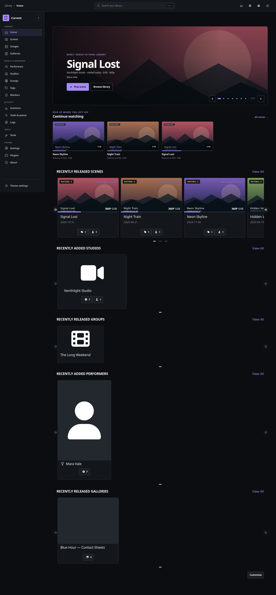
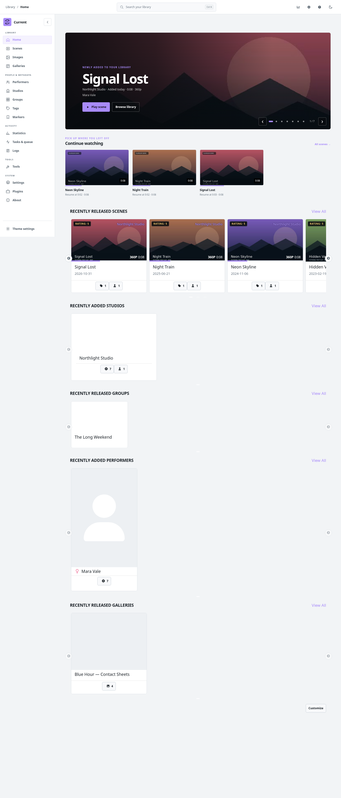
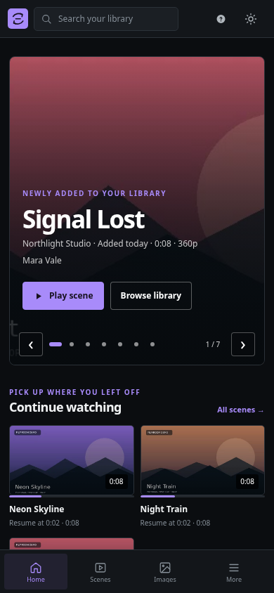
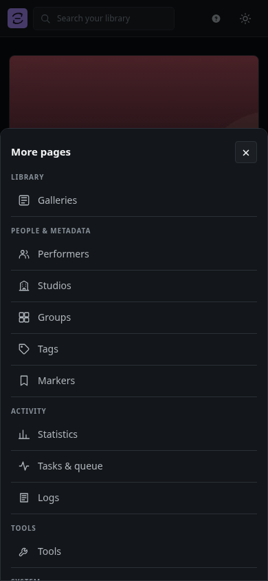
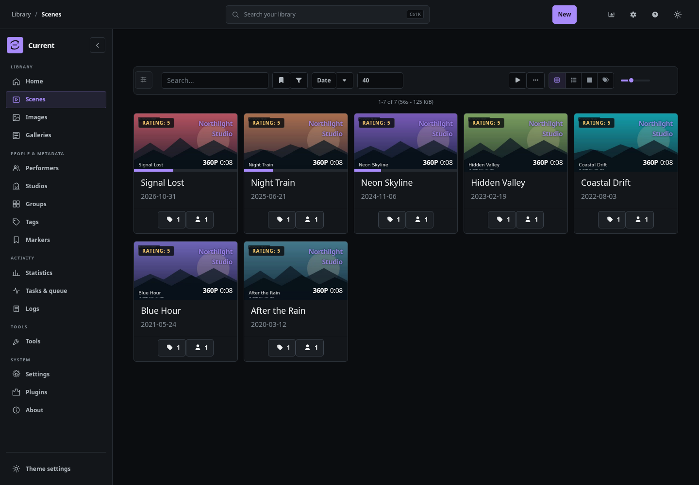
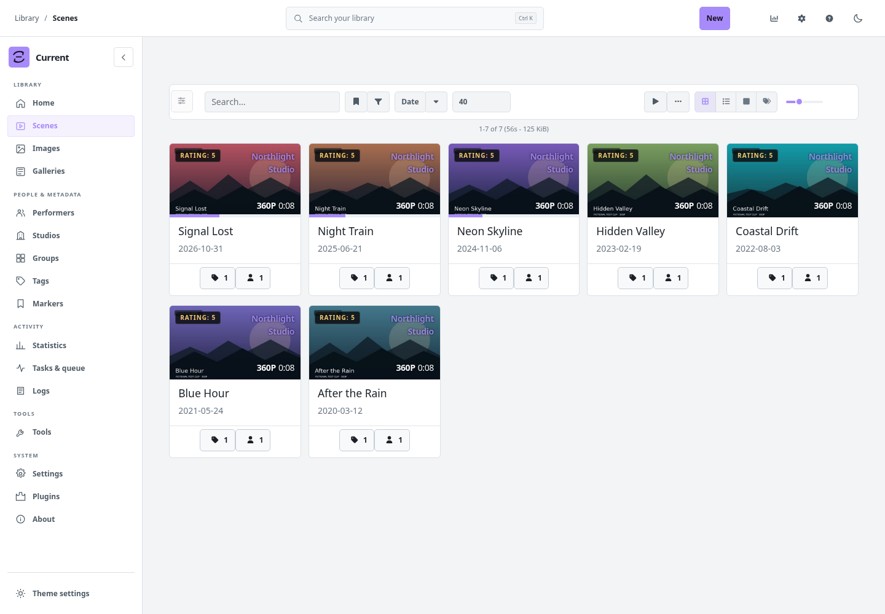
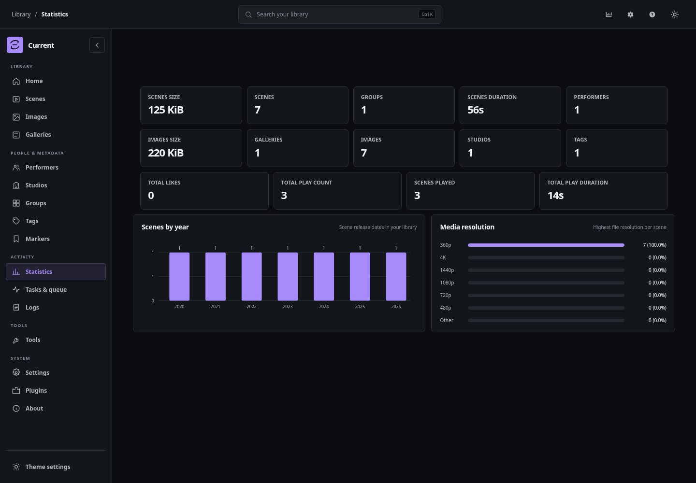
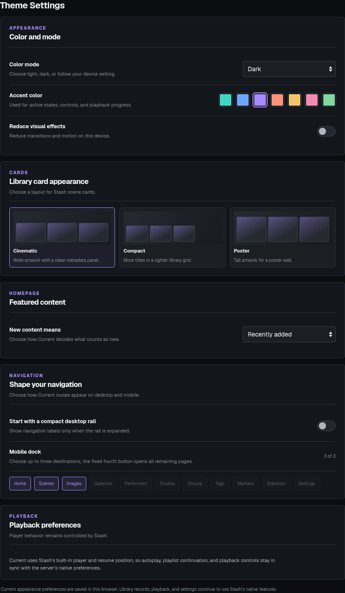
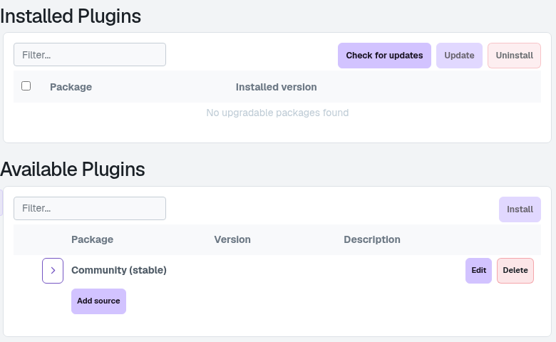

# Current Theme

Current is a video-first Stash theme plugin with Geist typography, a responsive library rail, a large home carousel for new arrivals, a Continue Watching row, and a Stash box mark whose tile follows the selected accent. It also themes the native Settings sections, including their form rows, scraper tables, task queue, logs, and status colors; Settings switches remain beside their labels on phones. Its Interface settings let you choose one or two scene columns on mobile. Other features include distinct accent-filled tag chips, neutral Tagger results, square mobile include/exclude controls, wrapped performer controls, compact tag actions, theme-styled dropdown menus across Stash actions, selects, and the video player, light and dark modes, seven accent colors, and Soft Fill buttons. Its sharp-cornered switches use Current's accent and surface colors. It preserves Stash's own player, library operations, and customizable recommendation shelves. Its plugin ID and folder consistently use `current-theme`.

The home carousel and Continue Watching shelf use Stash GraphQL scene data. New arrivals can sort by the library-add time or scene release date. Continue Watching filters scenes with a saved resume position and opens the normal Stash scene route, where the built-in player applies Stash's resume behavior.

Geist Variable Sans 5.3.0 from Fontsource is bundled under the SIL Open Font License 1.1 and loads through Stash's local plugin asset route, so the theme does not need a remote font request.

Theme preferences are stored in the current browser. The login page is served outside Stash's plugin UI, so a theme plugin alone cannot restyle it. FrontPage component patching uses Stash's documented experimental UI plugin API and should be checked against each Stash release.

## Development install

Copy this directory into Stash's configured `plugins/` directory, reload plugins in **Settings → Plugins**, then enable **Current Theme**. After updating, reload the Stash UI in the browser so the new JavaScript and CSS load. Disable other full-app theme plugins while testing it so global styles do not conflict.

For a packaged manual install, download [Current Theme 0.1.48](../../packages/current-theme/0.1.48-manual.zip) and extract its `current-theme/` folder into the configured plugins directory.

## Screenshots

These screenshots were captured from a live Stash 0.32.0 instance running Current Theme. The library contains only fictional, non-explicit demo clips created for this capture.

### Home

The new-arrivals carousel leads the page and automatically advances every seven seconds while the page is visible. Its arrows, dots, keyboard controls, and touch swipes remain available. Continue Watching sits directly below it, followed by Stash's existing recommendation shelves.

The mobile dock always has four items: three destinations you choose in **Settings → Interface → Theme Settings** and a final **More** button that opens the remaining pages. Stash settings show one category at a time, with a wrapped tab bar on desktop and a section picker on phones. Current themes the native section rows, tables, logs, task states, and feedback colors throughout Settings. The native Plugins filter remains available, and the installed plugin list scrolls inside its panel.

### Scene library

### Statistics

### Current Theme settings

### Buttons

Soft Fill uses pale accent fills for primary actions, a matching accent outline for secondary actions, and a separate red treatment for destructive actions. The outline text deepens in light mode for contrast.

## Visual audit

The current UI was checked in a live Stash 0.32.0 instance at desktop and mobile widths. The audit covered the home carousel and Continue Watching shelf, scene filters and zoom, statistics cards and charts, theme settings embedded under **Settings → Interface**, native settings and logs, navigation, and the light/dark appearance. All twelve native Settings sections were selected at desktop width, and the mobile section picker was used to change sections. Scene Tagger result rows use neutral surfaces; include/exclude controls stay square at phone widths, performer action groups wrap inside the result card, and tag suggestion buttons stay separate. Search, automatic and manual carousel navigation, accent changes, card layout, the three-destination mobile dock and its More menu, flyout labels with the desktop rail collapsed, reduced effects, and sidebar collapse were exercised in the browser. Library mutations, playback, detail pages, and server settings stay on Stash's native routes and APIs.

The library in the screenshots contains fictional, non-explicit demo clips.

The plugin has no external dependencies or build step. Its JavaScript and manifest can be syntax-checked directly with Node; its styles load from `css/current-theme-0.1.48.css`.

Current is distributed under [AGPL-3.0](./LICENSE).
