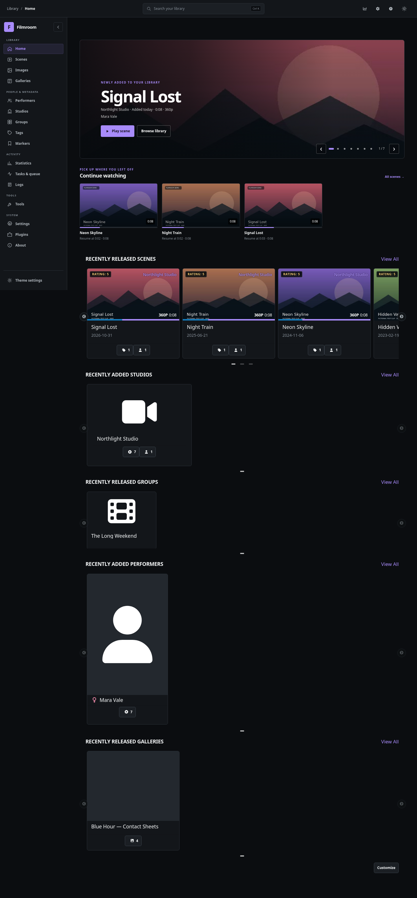
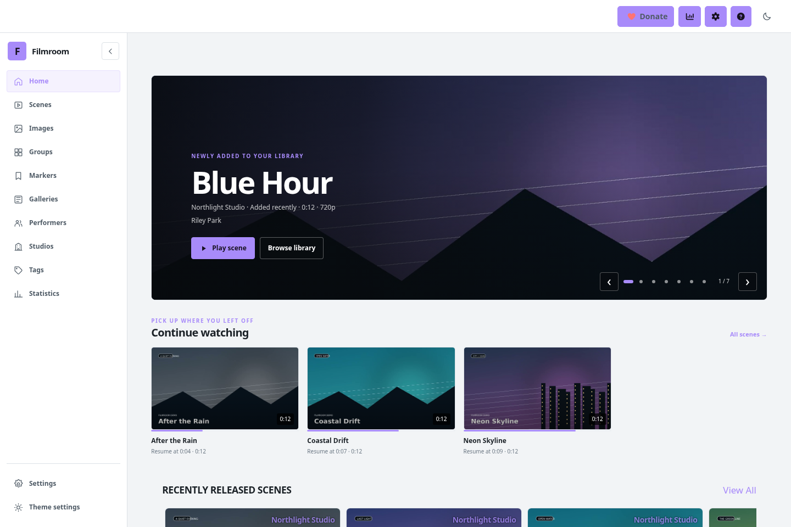
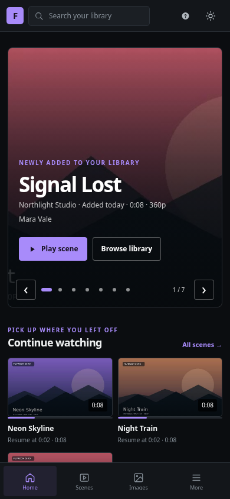
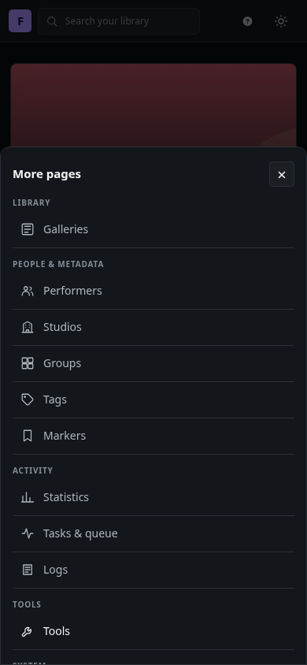
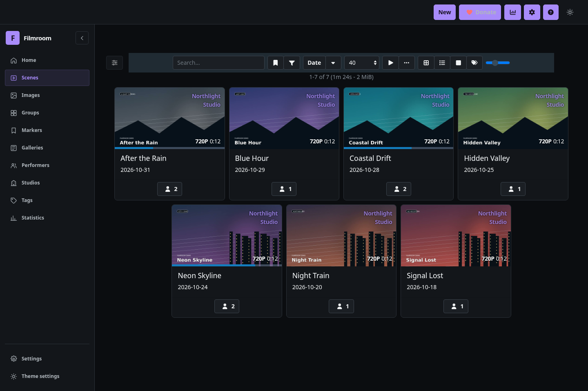
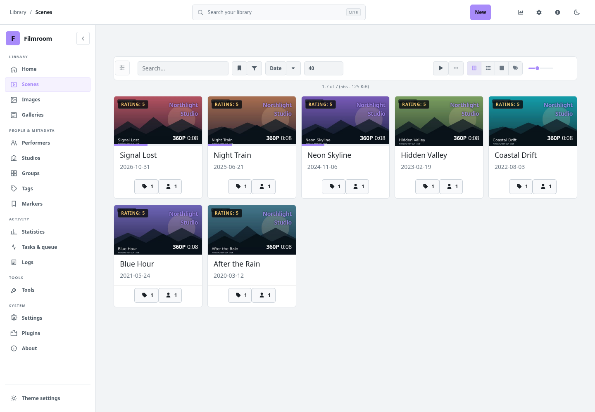
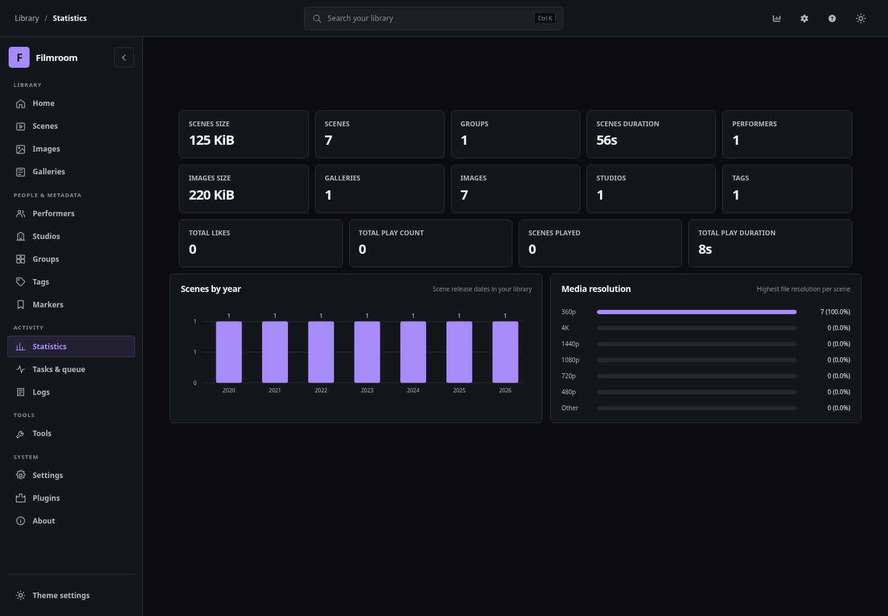
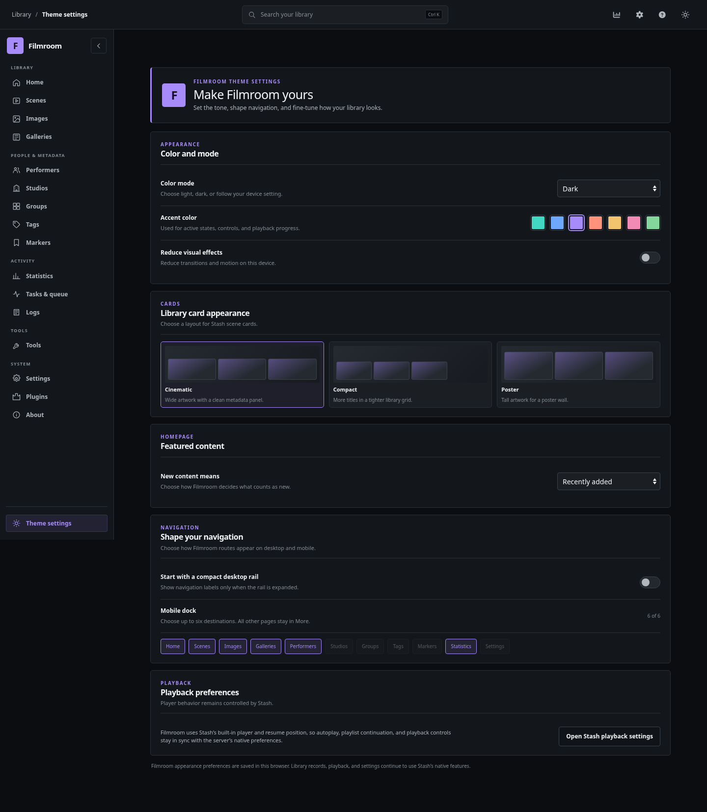

# Filmroom Theme

Filmroom is a video-first Stash theme plugin with a responsive library rail, a large home carousel for new arrivals, a Continue Watching row, light and dark modes, and seven accent colors. It preserves Stash's own player, library operations, and customizable recommendation shelves.

The home carousel and Continue Watching shelf use Stash GraphQL scene data. New arrivals can sort by the library-add time or scene release date. Continue Watching filters scenes with a saved resume position and opens the normal Stash scene route, where the built-in player applies Stash's resume behavior.

Theme preferences are stored in the current browser. The login page is served outside Stash's plugin UI, so a theme plugin alone cannot restyle it. FrontPage component patching uses Stash's documented experimental UI plugin API and should be checked against each Stash release.

## Development install

Copy this directory into Stash's configured `plugins/` directory, reload plugins in **Settings → Plugins**, then enable **Filmroom Theme**. Disable other full-app theme plugins while testing it so global styles do not conflict.

For a packaged manual install, download [Filmroom Theme 0.1.5](../../packages/filmroom-theme/0.1.5-manual.zip) and extract its `filmroom-theme/` folder into the configured plugins directory.

## Screenshots

These screenshots were captured from a live Stash 0.32.0 instance running Filmroom Theme. The library contains only fictional, non-explicit demo clips created for this capture.

### Home

The new-arrivals carousel leads the page, with Continue Watching directly below it. Stash's existing recommendation shelves remain further down the page.

The mobile dock always has four items: three destinations you choose in Theme settings and a final **More** button that opens the remaining pages.

### Scene library

### Statistics

### Theme settings

## Visual audit

The current UI was checked in a live Stash 0.32.0 instance at desktop and mobile widths. The audit covered the home carousel and Continue Watching shelf, scene filters and zoom, statistics cards and charts, theme settings, native settings and logs, navigation, and the light/dark appearance. Search, carousel navigation, accent changes, card layout, the three-destination mobile dock and its More menu, flyout labels with the desktop rail collapsed, reduced effects, and sidebar collapse were exercised in the browser. Library mutations, playback, detail pages, and server settings stay on Stash's native routes and APIs.

The library in the screenshots contains fictional, non-explicit demo clips.

The plugin has no external dependencies or build step. Its JavaScript and manifest can be syntax-checked directly with Node; its styles load from `css/filmroom.css`.

Filmroom is distributed under [AGPL-3.0](./LICENSE).
