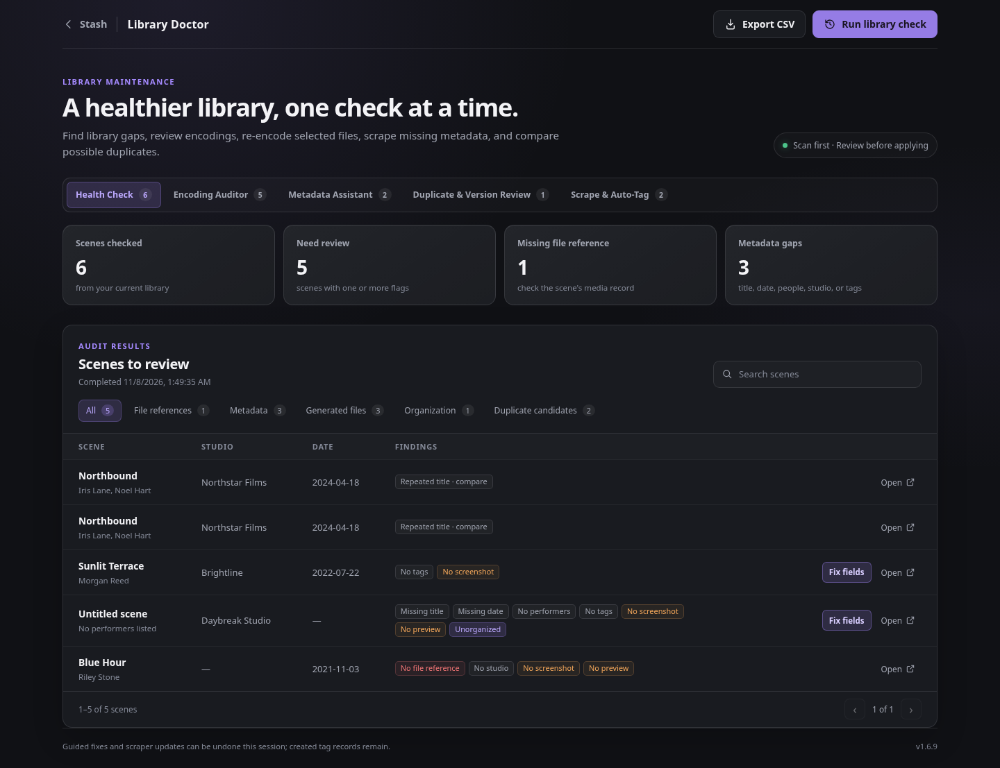
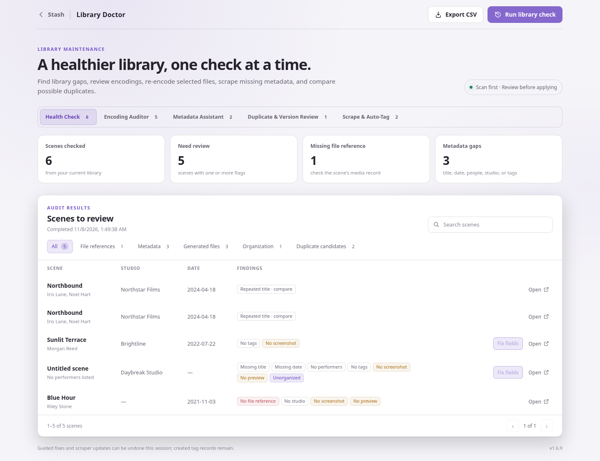
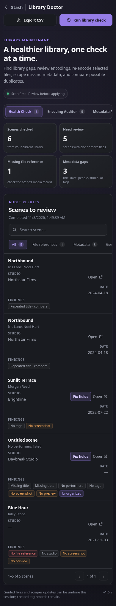
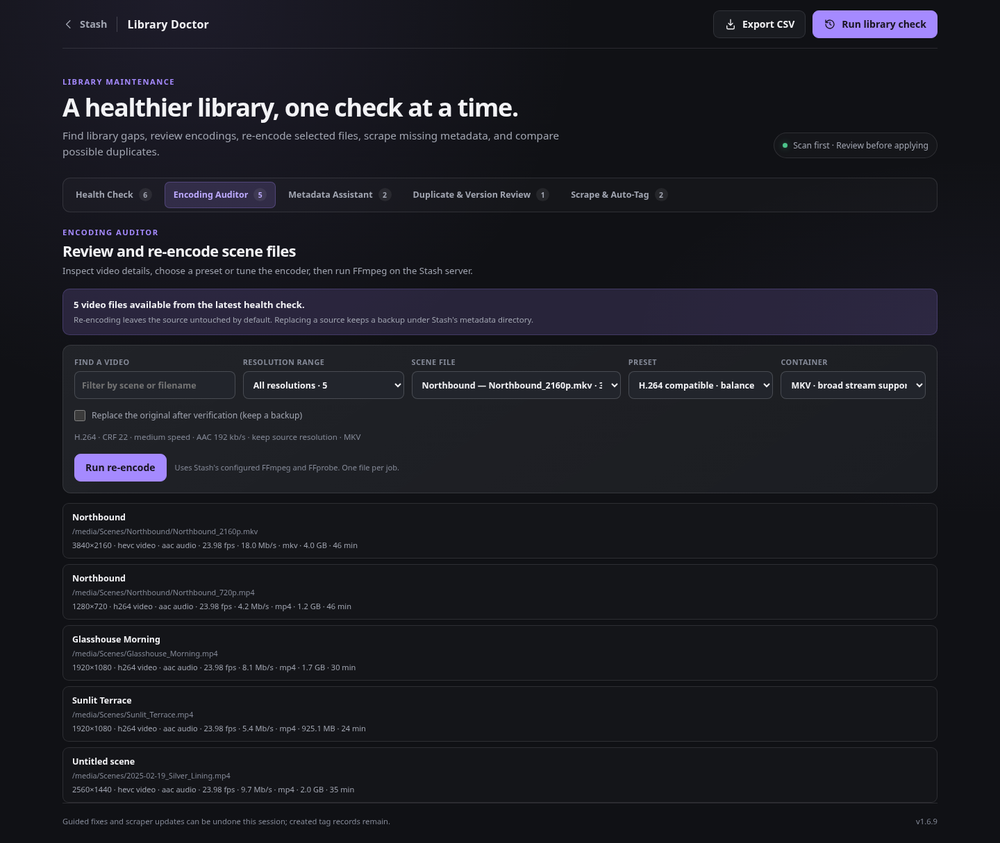
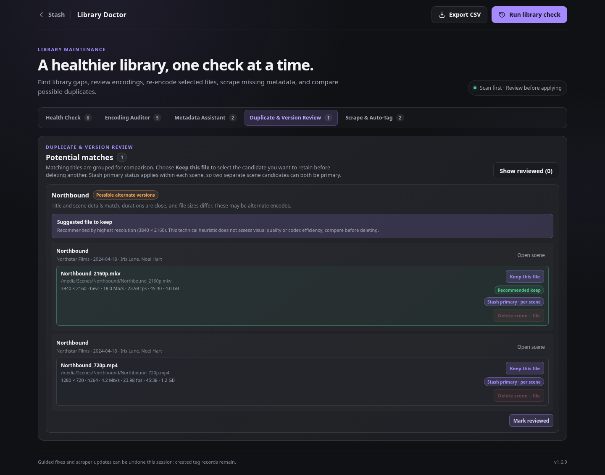

# Library Doctor

Library Doctor checks scene records for common metadata, generated-file, and encoding details. It adds an icon beside the right-side utility controls in Stash's navigation and opens a responsive dashboard.

Library Doctor has five workspaces: **Health Check**, **Encoding Auditor**, **Metadata Assistant**, **Duplicate & Version Review**, and **Scrape & Auto-Tag**. Health Check scans for missing file references, titles, dates, performers, studios, tags, screenshots, and previews; scenes marked unorganized; repeated titles; and video details used by Encoding Auditor.

**Encoding Auditor** lists the scene's video codec, audio codec, resolution, format, frame rate, bitrate, duration, and size. Filter the latest scan by resolution bands (480p and below, above 480p through 720p, and higher ranges) or choose an exact resolution detected in the library; each option shows its matching file count. Title and filename search combine with the resolution filter. Choose a video and submit an FFmpeg job to Stash. Presets include H.264 compatibility (CRF 22, AAC 192 kb/s), higher-quality H.264 (CRF 18, slow), space-saving H.265 (CRF 28), and higher-quality H.265 (CRF 23, slow). **Custom settings** let you choose H.264 or H.265, CRF 16–35, fast/medium/slow encoding, a maximum resolution, audio copy or AAC bitrate, and MKV or MP4 output.

The default writes a new file under Stash's configured metadata directory at `LibraryDoctor/Reencoded/`; the original stays in place. To replace an original, enable the explicit replacement option. Library Doctor supports in-place replacement only when the source and selected container are both MP4 or both MKV. It verifies the temporary output with FFprobe, copies the original to `LibraryDoctor/Backups/`, atomically installs the new file, then queues a Stash metadata refresh. Check available disk space before replacing a large file. New-copy output is not added to a scene automatically. Lower CRF targets higher quality and usually creates a larger file; encoding does not guarantee a smaller output, so review the result before using it.

Re-encoding requires Stash's configured Python 3.8 or newer and working FFmpeg/FFprobe binaries available through Stash's configured paths, the server PATH, or the config directory. The selected video codec must be supported by that FFmpeg build (`libx264` for H.264 or `libx265` for H.265). Task progress is reported through Stash's Python API and reads FFmpeg's microsecond or timestamp progress fields.

## Requirements and compatibility

Library Doctor uses Stash's plugin UI assets and local GraphQL API. Use a current Stash release with plugin UI and raw task support; the re-encode task specifically requires Python 3.8 or newer. FFmpeg and FFprobe are needed only for encoding. They must be available to the Stash server process or configured in **Settings → Configuration → General**. The plugin has no additional Python package dependencies.

Run a scan to see counts, filter findings, search by scene title, studio, performer, or issue, and export flagged scenes to CSV. The **Metadata Assistant** proposes missing titles and dates from scene filenames and lists scenes without tags. For missing tags, select one or more existing Stash tags in the guided fix dialog. Title and date suggestions remain editable and are never applied automatically. Each finding links to its scene in Stash. Before applying a selected title, date, or tags, Library Doctor shows a before-and-after preview and checks that text fields have not changed since the scan. **Undo last fix** restores the previous values if they have not changed since; the latest 20 fixes can be undone during the current dashboard session.

**Scrape & Auto-Tag** uses Stash’s configured scene-identify sources, in their configured order, including Stash-box providers. Installed scene scrapers that are not in that order are also listed individually. If Stash has no configured order, the workspace lists all installed scene scrapers and lets you run all or choose one. It sends batches of scenes with a missing title, date, or tags through Stash’s fingerprint lookup. A single result may fill only a blank title or date and add its tags; existing tags are merged and preserved. Multiple results are held for manual selection, and scenes without a match remain unchanged. The optional missing-tag creation control is on by default; Stash tag records created this way remain if you undo the scene update. Recent scene updates share the same 20-entry session undo history.

**Duplicate & Version Review** groups scenes with matching normalized titles and lists every attached file with its full path, resolution, video codec, bitrate, frame rate, duration, and size. It recommends a file to keep by comparing resolution first, then bitrate, frame rate, and size; if the available measurements are tied or incomplete, it reports that there is no clear recommendation. This technical heuristic cannot assess visual quality or codec efficiency, so compare files before acting. Matching titles alone do not prove two scenes are duplicates, and marking a group reviewed is saved in the current browser. Choose **Keep this file** to make an explicit group-level selection before deleting any candidate. Stash's primary-file status applies independently to each scene, so separate candidates can both show **Stash primary · per scene**. For a scene with multiple attached files, use **Set primary** to promote another file before deleting a non-primary file. For a single-file scene, **Delete scene + file** removes the entire scene record, its metadata, and its file from disk; this action requires confirmation and cannot be undone from Library Doctor. The selected keeper is protected from deletion.

Add the **MirageOne Stash Plugins** source in **Settings → Plugins → Add source** using the index URL from the [repository README](../../README.md), then install **Library Doctor** from **Available Plugins**. For a manual installation, download [the 1.6.11 manual archive](../../packages/library-doctor/1.6.11-manual.zip) and extract its `library-doctor/` directory into Stash's configured plugins directory. Enable the plugin in **Settings → Plugins**. After updating, reload the plugin page and refresh the browser so its versioned assets load.

The Stash-side shortcut samples the active interface's computed styles before opening the dashboard in Stash's main view, where the dashboard is embedded in the registered Stash route, then refreshes its theme snapshot when Stash changes themes or stylesheets. This carries user-selected colors, surfaces, typography, control styling, and light or dark mode into Library Doctor, including themes that do not publish Library Doctor-specific tokens.

## Screenshots

These screenshots were captured from Library Doctor 1.6.10 in a local Stash-compatible preview using fictional scene and file data. They show the responsive dashboard and its main review workspaces.

## Troubleshooting

- If the navigation shortcut is missing, check that Library Doctor is enabled, reload the plugin list, then refresh Stash in the browser.
- If **Scrape & Auto-Tag** has no sources, configure scene-identify sources under **Settings → Metadata Providers** and reload the dashboard.
- If an encode cannot find FFmpeg or FFprobe, set their paths in **Settings → Configuration → General** and confirm the Stash server account can read the scene and write to its metadata directory.
- If a re-encode fails, check the task details and Stash log. Replacement is opt-in; when enabled, the plugin keeps a backup under the metadata directory before installing the verified output.
