# Rebirth

Rebirth is a video-first Stash theme plugin with Geist typography, a responsive library rail, a large home carousel for new arrivals, a Continue Watching row, and a Stash box mark whose tile follows the selected accent. Performer, studio, group, and tag detail headers use neutral raised cards in light and dark modes, and their rating stars share one joined control surface. The Tags page replaces icon tiles with a compact hierarchy directory showing parent relationships, child-tag counts, optional tag images, and linked counts for scenes, images, galleries, groups, markers, performers, and studios. Stash has no separate tag-category entity, so the directory uses its native parent-child relationships. Favorite toggles remain available beside tag names; hierarchy and parent selectors plus a horizontally scrollable A–Z index make large tag libraries quicker to browse. The existing native search, sorting, pagination, bulk selection, actions, and Tagger view remain available. Its single top-bar plugin launcher gathers installed utility pages into an icon-centered, accent-aware flyout, while preserving each plugin's normal navigation behavior. It also themes the native Settings sections, including their form rows, scraper tables, task queue, logs, status colors, informational states, and Help modal surfaces and navigation; Settings switches stay beside their labels on phones and keep equal thumb insets in both positions. Scene and performer lists use a responsive pagination bar that places the result range beside the native page controls on desktop and stacks them on phones; the sticky footer keeps the same compact controls. The Plugins package manager puts its filter above a fixed action row, with reserved positions for controls that appear after an update check. Its Interface settings let you choose one or two scene columns on mobile. Other features include distinct accent-filled tag chips, neutral Tagger results, square mobile include/exclude controls, performer actions with consistent spacing that wrap to fit, a Rebirth-colored filter sidebar aligned beside the navigation rail and collapsed by default on performer lists and fully hidden when collapsed on performer, studio, group, and tag detail pages, compact tag actions, theme-styled dropdown menus across Stash actions, selects, and the video player, light and dark modes, and eight distinct accent colors: Teal, Blue, Violet, Coral, Amber, Rose, Red, and Green. Teal is now more blue-green, and Red adds a distinct red choice beside Coral and Rose. Primary actions use the selected accent with contrasting text, while secondary actions use accent outlines and destructive actions keep their semantic treatment. Saved choices from Rebirth 1.0.1 map to their closest existing hue; all earlier choices remain available. The Statistics page keeps all native entity-count cards and adds responsive scenes-by-year, media-resolution, never-played scenes, rating distribution, library breakdown, and rankings for most-watched scenes, performers, studios, and tags. Ranked play totals link to Stash records; the performer list can be filtered to all, female, or male performers in Theme Settings. It preserves Stash's own player, library operations, and customizable recommendation shelves. Its plugin ID and folder consistently use `rebirth`.

The Plugins settings page reserves a consistent column for each plugin's settings expander, keeping its link and Enable/Disable buttons aligned across rows. The home carousel and Continue Watching shelf use Stash GraphQL scene data. The carousel can show recently added scenes, recently released scenes, or a random group of scenes that changes on each page load. Carousel titles keep a larger minimum type size and use more of the fixed-height hero; exceptionally long titles remain scrollable. Continue Watching filters scenes with a saved resume position and opens the normal Stash scene route, where the built-in player applies Stash's resume behavior.

Scene cards use Stash's scene screenshot image and native hover-preview video; Rebirth changes their presentation, not which image Stash supplies. Poster cards fit the screenshot and preview inside the tall frame so wide images remain fully visible instead of being cropped.

Geist Variable Sans 5.3.0 from Fontsource is bundled under the SIL Open Font License 1.1 and loads through Stash's local plugin asset route, so the theme does not need a remote font request.

When signed in, Rebirth stores appearance preferences in Stash's per-user UI configuration through the native `configureUI` API. The browser keeps a local cache for immediate display, while Stash's account settings restore the same appearance across browsers and incognito sessions. Existing browser preferences migrate into the signed-in account the first time the account settings are available. The login page is served outside Stash's plugin UI, so a theme plugin alone cannot restyle it. FrontPage component patching uses Stash's documented experimental UI plugin API and should be checked against each Stash release.

## Requirements and compatibility

Rebirth is built for Stash 0.32 and its plugin UI APIs. Its filter, Settings, and Help styling also follows parts of Stash's native page structure, so review it after Stash upgrades. Rebirth has no external runtime dependencies, sends no appearance data to third-party services, and includes its font files locally.

## Install

Add the **MirageOne Stash Plugins** source in **Settings → Plugins → Add source** using the index URL in the [repository README](../../README.md), then install **Rebirth** from **Available Plugins**. To install manually, download [Rebirth 1.2.15](../../packages/rebirth/1.2.15-manual.zip) and extract its `rebirth/` folder into Stash's configured plugins directory. Enable it in **Settings → Plugins** and refresh Stash in the browser after updating so the versioned JavaScript and CSS load.

The one- or two-column mobile scene grid and the four-item navigation dock are configured in **Settings → Interface → Theme Settings**. Disable other full-app theme plugins while checking Rebirth so their global styles do not override its presentation.

## Local development

Copy or symlink this directory into Stash's configured `plugins/` directory, reload plugins in **Settings → Plugins**, then refresh Stash in the browser after changing versioned assets. Rebirth has no build step.

## Screenshots

These screenshots were captured from Rebirth 1.2.6 running on Stash 0.32.0. The isolated fixture uses a fictional performer and studio with generated artwork for three demo scenes. The plugin launcher screenshots show Rebirth's live flyout populated with the installed StashBox Metadata Review, Stash Downloader, and Library Doctor plugins.

### Home

Light mode, desktop:

Light mode, 390-pixel mobile width:

Dark mode, desktop and mobile:

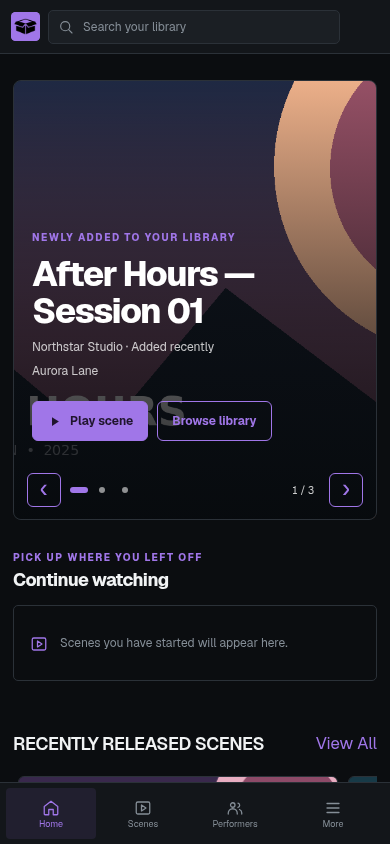

### Scene library

Light mode, desktop and mobile:

Dark mode, desktop and mobile:

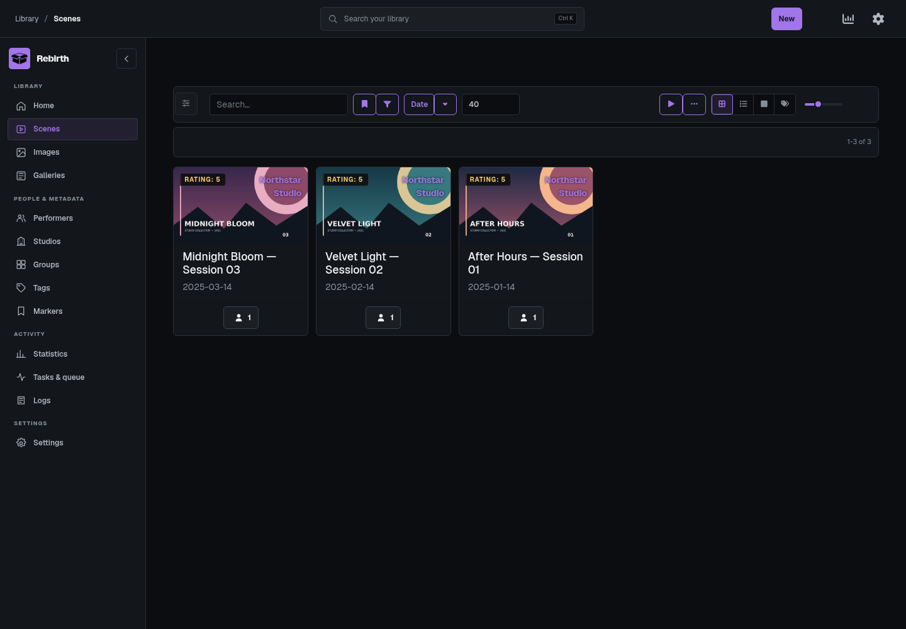

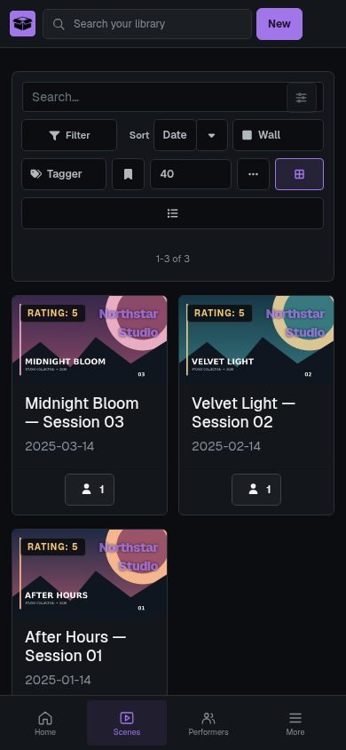

Poster layout keeps wide scene art fully visible inside the taller card:

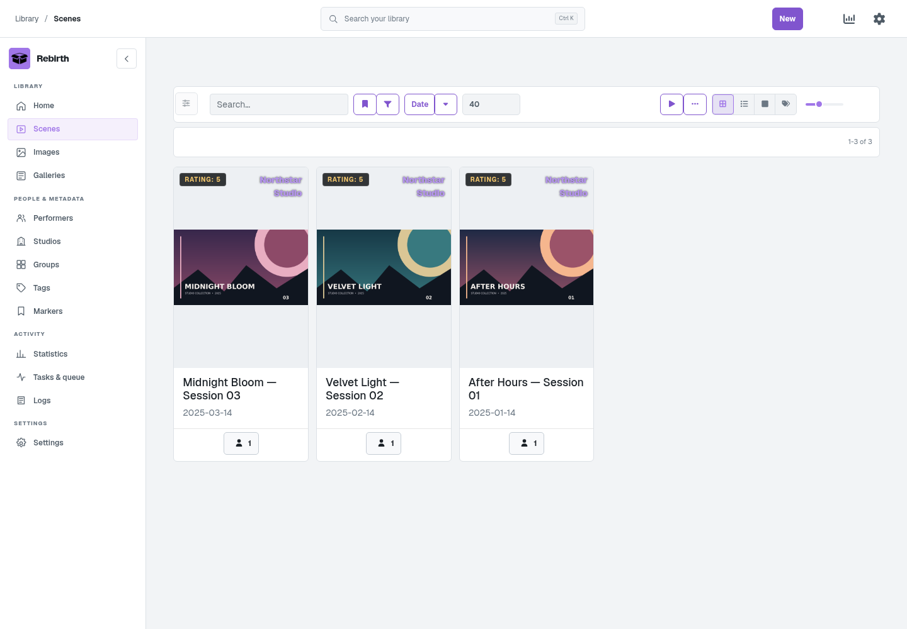

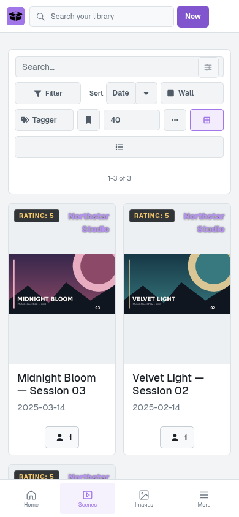

### Performer detail

The native filter opens on demand and remains selectable. Both light and dark modes show the detail card and grouped rating control; the filter dialog is included in each desktop set.

Dark mode:

Light mode:

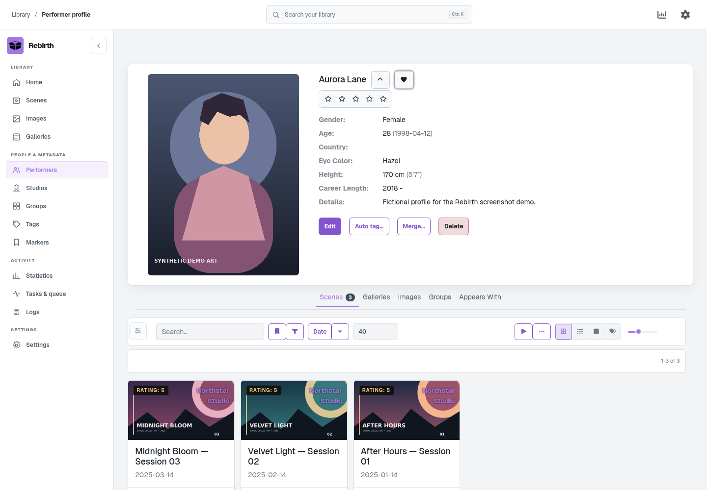

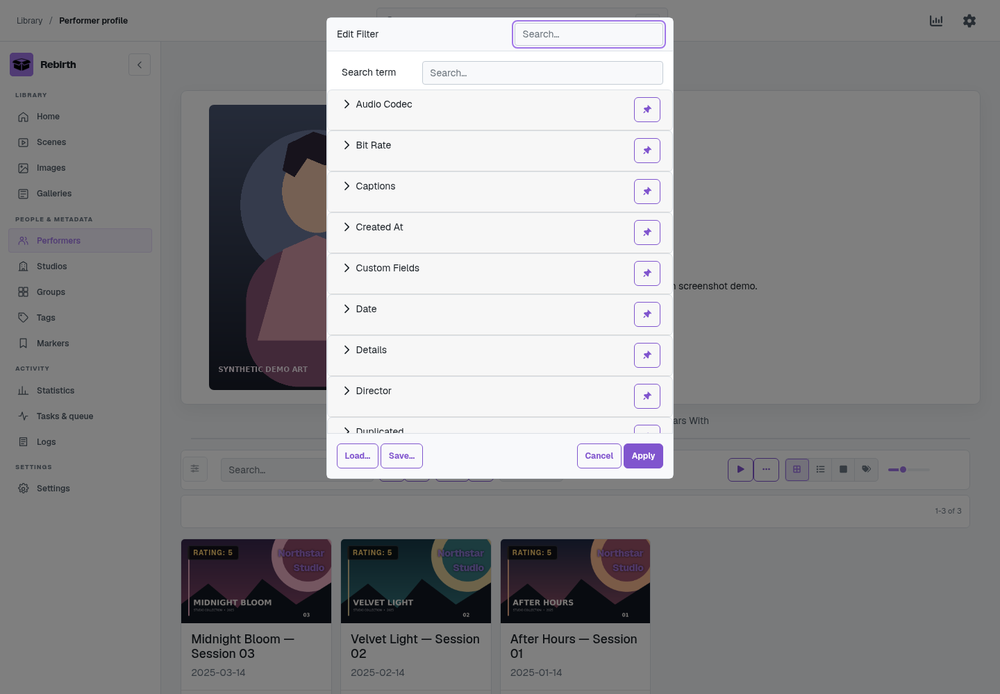

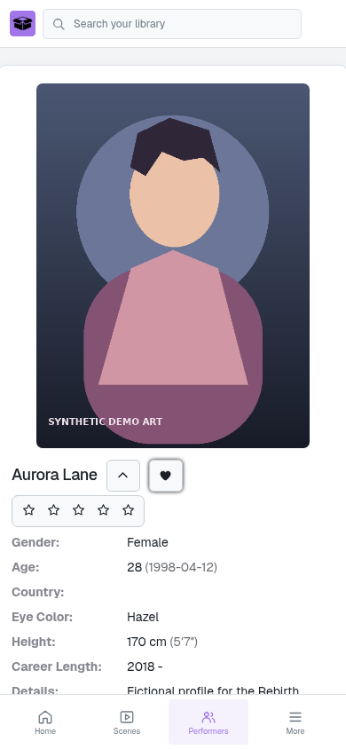

### Plugin launcher flyout

The app-grid button gathers installed plugin shortcuts into one icon-centered flyout. These images show the rendered Rebirth flyout on desktop and mobile in both color modes.

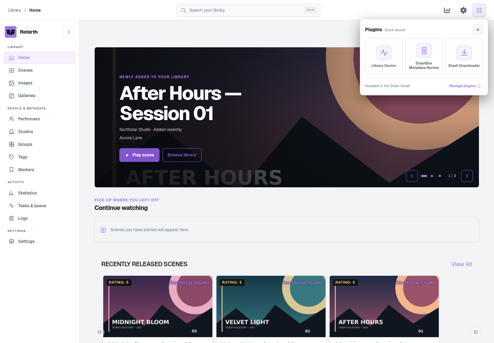

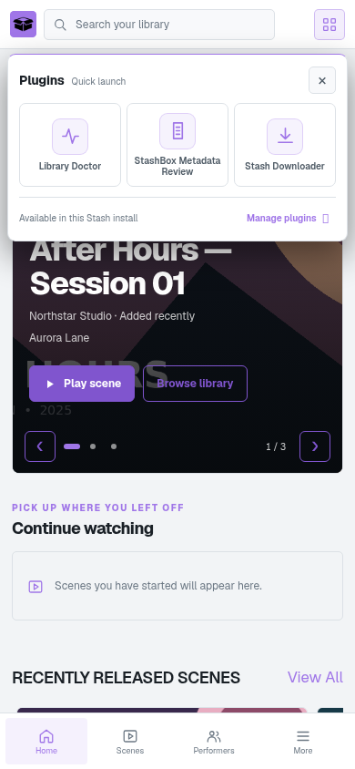

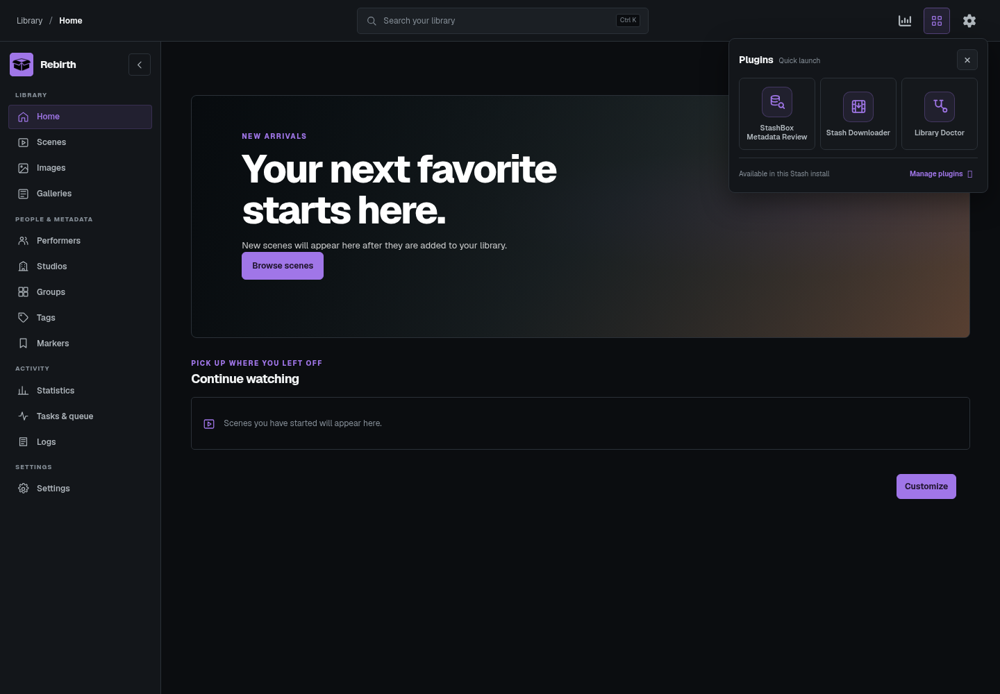

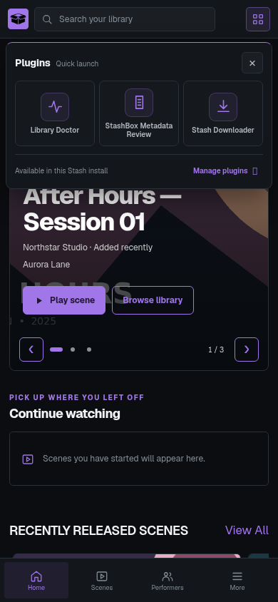

The mobile **More** flyout presents the remaining destinations as an icon-centered grid. [View the flyout mockup](mockups/navigation-flyout-mobile-neutral-icons-preview.png). The responsive scene and performer pagination is previewed in the [pagination mockup](mockups/pagination-bar.html), and the eight accent colors are compared in the [palette mockup](mockups/accent-palettes.html).

## Visual audit

Rebirth 1.2.6 was checked in an isolated Stash 0.32.0 instance at desktop and mobile widths in both color modes, including the performer filter dialog and the plugin launcher flyout. The random carousel source in 1.2.7 uses Stash's paginated scene query and shuffles its selected scenes on each load. Rebirth 1.2.10 keeps carousel titles larger at desktop and phone widths while using more of the fixed hero; exceptionally long titles remain accessible by scrolling inside the title area. The screenshot fixture contains only fictional metadata and generated demo artwork. The 1.2.2 tag directory was checked against Stash 0.32 tag and filter APIs in desktop and mobile browser fixtures from 320 to 1280 pixels. User preference persistence uses Stash 0.32's per-user `configuration.ui` and `configureUI(partial:)` GraphQL fields. Stash continues to handle library mutations, playback, and server settings through its native routes and APIs.

The plugin has no external dependencies or build step. Its JavaScript and manifest can be syntax-checked directly with Node; its styles load from `css/rebirth-1.2.15.css`.

Rebirth is distributed under [AGPL-3.0](./LICENSE).
