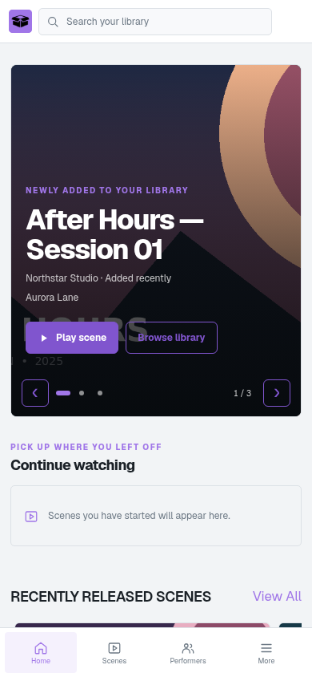
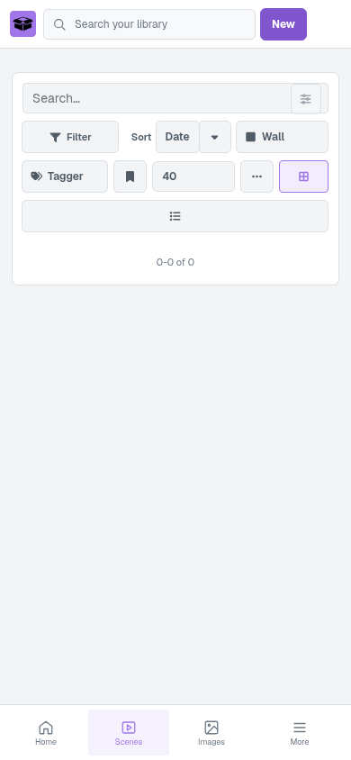
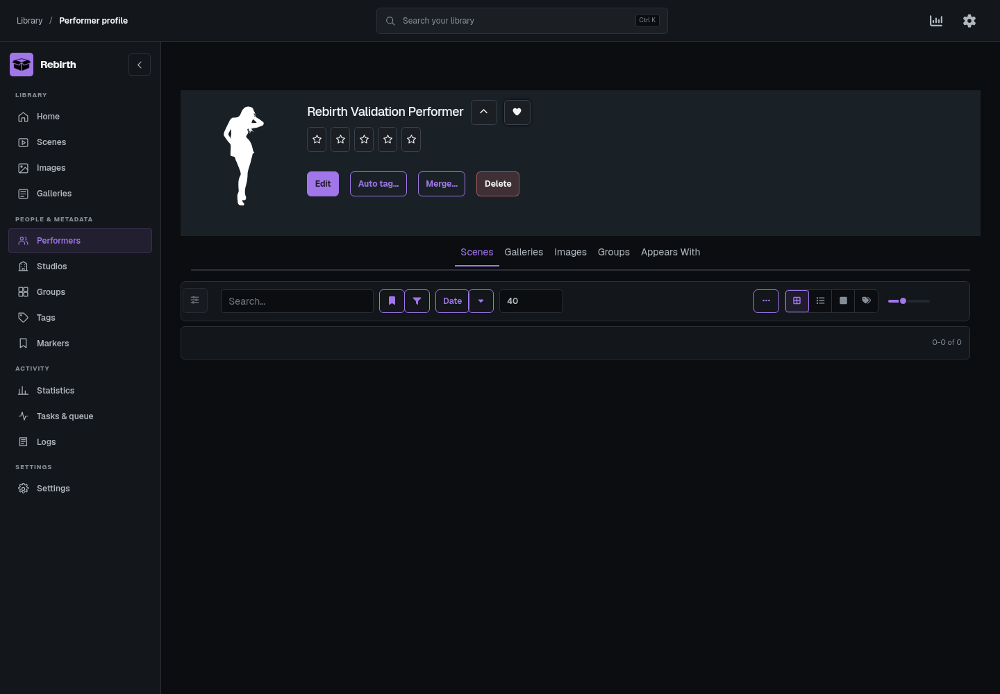
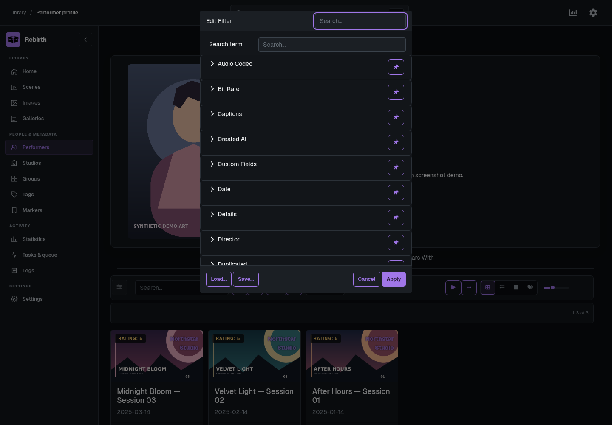
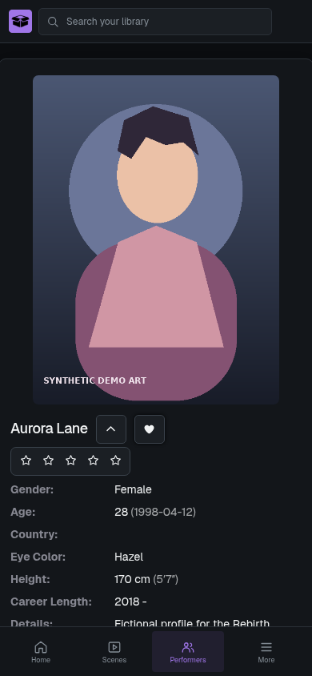
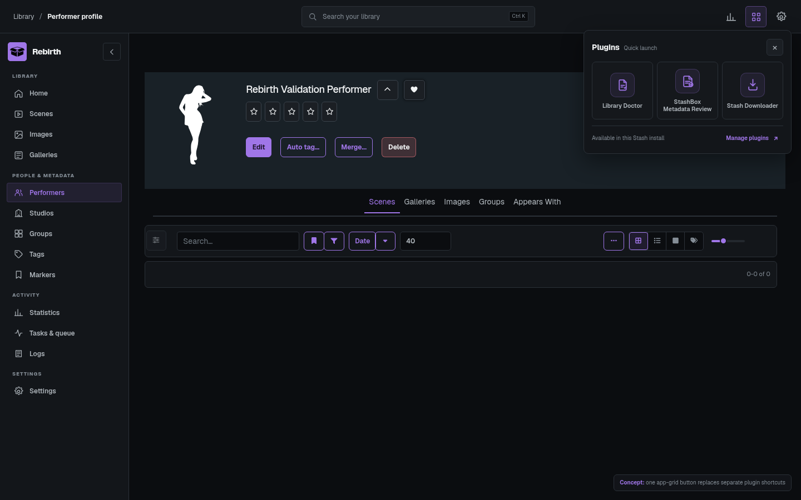
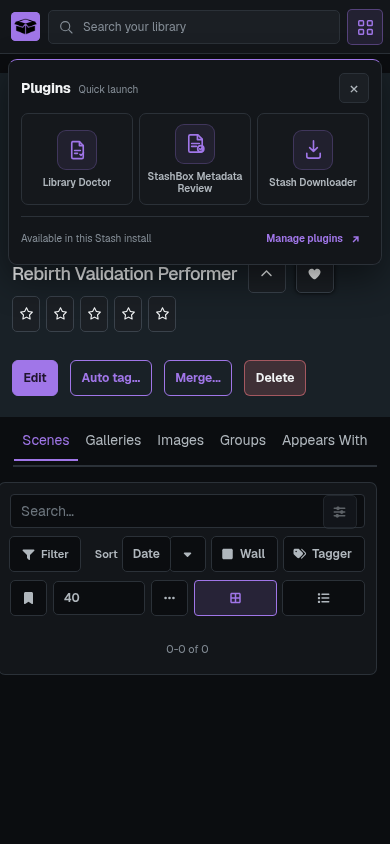

# Rebirth

Rebirth is a video-first Stash theme plugin with Geist typography, a responsive library rail, a large home carousel for new arrivals, a Continue Watching row, and a Stash box mark whose tile follows the selected accent. Performer, studio, group, and tag detail headers use neutral raised cards in light and dark modes, and their rating stars share one joined control surface. Its single top-bar plugin launcher gathers installed utility pages into an icon-centered, accent-aware flyout, while preserving each plugin's normal navigation behavior. It also themes the native Settings sections, including their form rows, scraper tables, task queue, logs, status colors, informational states, and Help modal surfaces and navigation; Settings switches stay beside their labels on phones and keep equal thumb insets in both positions. Scene and performer lists use a responsive pagination bar that places the result range beside the native page controls on desktop and stacks them on phones; the sticky footer keeps the same compact controls. The Plugins package manager puts its filter above a fixed action row, with reserved positions for controls that appear after an update check. Its Interface settings let you choose one or two scene columns on mobile. Other features include distinct accent-filled tag chips, neutral Tagger results, square mobile include/exclude controls, performer actions with consistent spacing that wrap to fit, a Rebirth-colored filter sidebar aligned beside the navigation rail and collapsed by default on performer lists and fully hidden when collapsed on performer detail pages, compact tag actions, theme-styled dropdown menus across Stash actions, selects, and the video player, light and dark modes, and eight distinct accent colors: Teal, Blue, Violet, Coral, Amber, Rose, Red, and Green. Teal is now more blue-green, and Red adds a distinct red choice beside Coral and Rose. Primary actions use the selected accent with contrasting text, while secondary actions use accent outlines and destructive actions keep their semantic treatment. Saved choices from Rebirth 1.0.1 map to their closest existing hue; all earlier choices remain available. It preserves Stash's own player, library operations, and customizable recommendation shelves. Its plugin ID and folder consistently use `rebirth`.

The home carousel and Continue Watching shelf use Stash GraphQL scene data. New arrivals can sort by the library-add time or scene release date. Continue Watching filters scenes with a saved resume position and opens the normal Stash scene route, where the built-in player applies Stash's resume behavior.

Geist Variable Sans 5.3.0 from Fontsource is bundled under the SIL Open Font License 1.1 and loads through Stash's local plugin asset route, so the theme does not need a remote font request.

When signed in, Rebirth syncs appearance preferences to server-side plugin settings keyed by the authenticated Stash user ID. Existing account and browser preferences migrate on first use; later sessions use the account copy across browsers, including incognito. The browser keeps a local cache and remains the fallback when the session identity or server-side plugin settings are unavailable. No preferences are written to Stash's user record. The login page is served outside Stash's plugin UI, so a theme plugin alone cannot restyle it. FrontPage component patching uses Stash's documented experimental UI plugin API and should be checked against each Stash release.

## Requirements and compatibility

Rebirth is built for Stash 0.32 and its plugin UI APIs. Its filter, Settings, and Help styling also follows parts of Stash's native page structure, so review it after Stash upgrades. Rebirth has no external runtime dependencies, sends no appearance data to third-party services, and includes its font files locally.

## Install

Add the **MirageOne Stash Plugins** source in **Settings → Plugins → Add source** using the index URL in the [repository README](../../README.md), then install **Rebirth** from **Available Plugins**. To install manually, download [Rebirth 1.1.9](../../packages/rebirth/1.1.9-manual.zip) and extract its `rebirth/` folder into Stash's configured plugins directory. Enable it in **Settings → Plugins** and refresh Stash in the browser after updating so the versioned JavaScript and CSS load.

The one- or two-column mobile scene grid and the four-item navigation dock are configured in **Settings → Interface → Theme Settings**. Disable other full-app theme plugins while checking Rebirth so their global styles do not override its presentation.

## Local development

Copy or symlink this directory into Stash's configured `plugins/` directory, reload plugins in **Settings → Plugins**, then refresh Stash in the browser after changing versioned assets. Rebirth has no build step.

## Screenshots

These screenshots were captured from Rebirth 1.1.7 running on Stash 0.32.0. The test library contains one fictional performer and no scenes, so the home page shows its empty new-arrivals state and the scene library is empty. The collapsed native filter is hidden when the performer detail page opens and remains available from its filter button.

### Home in light mode

### Scene library in light mode

### Performer detail in dark mode

The native filter opens on demand and remains selectable:

### Performer detail on mobile

The mobile **More** flyout presents the remaining destinations as an icon-centered grid. [View the flyout mockup](mockups/navigation-flyout-mobile-neutral-icons-preview.png). The responsive scene and performer pagination is previewed in the [pagination mockup](mockups/pagination-bar.html), and the eight accent colors are compared in the [palette mockup](mockups/accent-palettes.html).

### Plugin launcher preview

Rebirth 1.1.8 replaces separate plugin utility icons with one top-bar app-grid button. Its flyout shows shortcuts for installed plugin pages and includes a link to plugin management. These are design previews; the launcher behavior was checked in a browser fixture rather than captured from a live Stash instance.

## Visual audit

The Rebirth interface was checked in a clean Stash 0.32.0 instance at desktop and mobile widths, including the performer detail page with its filter closed and opened. Earlier browser checks covered the home carousel, Continue Watching, native Settings and Help, navigation, accent changes, light and dark appearance, and mobile layouts. Stash continues to handle library mutations, playback, and server settings through its native routes and APIs.

The plugin has no external dependencies or build step. Its JavaScript and manifest can be syntax-checked directly with Node; its styles load from `css/rebirth-1.1.9.css`.

Rebirth is distributed under [AGPL-3.0](./LICENSE).
